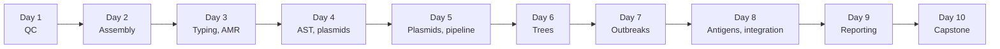
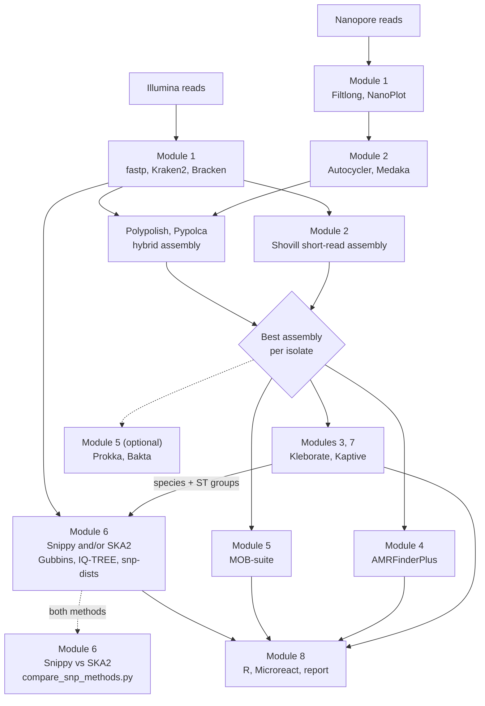

# Neonatal AMR Genomic Surveillance: Bioinformatics Course

**Bacterial genomics of *Klebsiella pneumoniae* and *Escherichia coli* from neonatal infections, using Illumina and Oxford Nanopore data**

A 10-day hands-on course. Each day has its own page, each page is split into course modules, and every
module ends with questions to check your understanding. Work through the pages in order.

---

## Contents

- [How to use this guide](#how-to-use-this-guide)
- [Course at a glance](#course-at-a-glance)
- [The questions this course answers](#the-questions-this-course-answers)
- [The training data](#the-training-data)
- [The analysis, end to end](#the-analysis-end-to-end)
- [Before Day 1](#before-day-1)
- [Getting help](#getting-help)
- [Trainer guide](TRAINER_GUIDE.md)

---

## How to use this guide

Each day page follows the same layout:

| Section | What it is for |
| --- | --- |
| **At a glance** | The day's sessions, modules and what you will produce |
| **Learning objectives** | What you should be able to do by the end of the day |
| **Module sections** | Short background, then numbered hands-on steps with commands |
| **Check your understanding** | Questions; click a question to reveal the answer |
| **End-of-day checklist** | Tick these off before you leave |

You will also see these boxes:

> [!NOTE]
> Background or context worth knowing.

> [!TIP]
> A shortcut or a better way of doing something.

> [!IMPORTANT]
> Something you must do for the next step to work.

> [!WARNING]
> A common mistake, or something that can give a misleading result.

<details>
<summary><b>Answers and hints look like this: click to open</b></summary>

Try each question yourself before opening the answer.

</details>

**Code blocks** are meant to be copied into your terminal. Lines starting with `#` are comments. Commands use
these shell variables, which you set up on Day 1:

| Variable | Meaning |
| --- | --- |
| `$COURSE` | Your course folder, e.g. `~/neonatal-amr-course` |
| `$READS` | Read files, named `<sample>_R1.fastq.gz`, `<sample>_R2.fastq.gz`, `<sample>_ont.fastq.gz` |
| `$RESULTS` | Where you write your own results |
| `$SHARED` | Read-only folder prepared by the trainers (data, databases, pre-computed results) |
| `$THREADS` | CPU threads each command may use: 1 in the interactive sessions (pipeline jobs get their own CPUs from Slurm) |
| `$SITE_CONFIG` | The pipeline's site config for this server, e.g. `conf/slurm.config` (Days 5 and 10) |

---

## Course at a glance

| Day | Morning | Afternoon | You will produce |
| --- | --- | --- | --- |
| [**Day 1**](day01.md) | Module 0: Linux, software environments, metadata | Module 1: Read QC and contamination | A QC pass/fail table |
| [**Day 2**](day02.md) | Module 2: Short-read assembly | Module 2: Long-read and hybrid assembly | An assembly QC table |
| [**Day 3**](day03.md) | Module 3: Species ID and typing | Module 4: AMR and virulence detection | A lineage summary |
| [**Day 4**](day04.md) | Module 4: Genotype vs phenotype, empiric therapy | Module 5: Plasmid reconstruction | A resistance summary |
| [**Day 5**](day05.md) | Module 5: Plasmid clustering and genetic context | Running the pipeline end to end | A plasmid figure; a full pipeline run |
| [**Day 6**](day06.md) | Module 6: Core SNPs and recombination | Module 6: Trees and SNP distances | A recombination-filtered tree |
| [**Day 7**](day07.md) | Module 6: Clusters and dating | Module 6: Infection prevention role play | An outbreak summary |
| [**Day 8**](day08.md) | Module 7: Capsule and O-antigen typing | Module 8: Bringing results together | A vaccine-coverage figure |
| [**Day 9**](day09.md) | Module 8: Figures and global context | Module 8: Reports and data sharing | A one-page brief |
| [**Day 10**](day10.md) | Capstone analysis | Capstone presentations | A capstone report |

A typical day runs in four sessions: **09:00–10:30**, **11:00–12:30**, **13:30–15:00** and **15:30–17:00**,
with a short lecture at the start of each module and a debrief at the end of the day.



---

## The questions this course answers

| # | Surveillance question | Module | Day |
| --- | --- | --- | --- |
| 1 | Is the sequencing data good enough, and is each culture pure? | 1 | 1 |
| 2 | Which species and lineages (STs) cause neonatal infection, and are they shared between facilities? | 3 | 3 |
| 3 | Which resistance genes are present, and do WHO-recommended empiric regimens still work? | 4 | 3–4 |
| 4 | Are resistance genes on plasmids that move between lineages or species? | 5 | 4–5 |
| 5 | Are hypervirulent, or resistant-and-hypervirulent, strains present? | 4 | 3–4 |
| 6 | Is there transmission within neonatal units? | 6 | 6–7 |
| 7 | Which capsule (K) and O-antigen types dominate, and what does that mean for vaccines? | 7 | 8 |
| 8 | How do we report all this to clinicians, infection control and national committees? | 8 | 8–9 |

> [!NOTE]
> Genomes alone cannot tell you incidence, mortality or risk factors. Those need denominators (admissions,
> blood cultures taken) and clinical data. Keep this in mind whenever you interpret a percentage.

---

## The training data

The course uses public genomes from a 20-year study of *K. pneumoniae* bloodstream infections at Queen Elizabeth
Central Hospital, Blantyre, Malawi
([Heinz et al., *Genome Medicine* 2024](https://doi.org/10.1186/s13073-024-01342-3)). Neonates accounted for 39%
of *K. pneumoniae* infections in that study. From its 1,373 genomes we use **29 isolates** chosen to cover every
module:

| Group | Isolates | Samples | Used on |
| --- | --- | --- | --- |
| **Hybrid**: Illumina + Nanopore | 3 | `CHI11E` (ST39), `CNS1F1` (ST45), `1013757` (ST3477) | Days 2, 4–5 |
| **ST39 cluster**: Chatinkha Nursery, 2017 | 8 | `CAA65Z` `CAA99X` `CAA47J` `CAA4X5` `CAA574` `CAA5XX` `CAA5YM` `CAA4GD` | Days 6–7 |
| ST39 background | 2 | `D29438` (2005), `BKR8JH` (2016) | Days 6–7 |
| **ST35 cluster**: Chatinkha Nursery, 2018 | 5 | `CAAGNM` `CAAGJF` `CAAGM3` `CAAG9G` `CAAHBT` | Days 6–7 |
| ST35 background | 1 | `D46705` (2008) | Days 6–7 |
| **Carbapenemase** (NDM-1) | 2 | `BHB7VE` (ST39), `CES1C7` (ST45) | Days 3–5 |
| **Lineage diversity** | 3 | `CAAWBC` (ST15), `CAASX8` (ST17), `CLL32W` (ST307) | Day 3 |
| **Virulence** | 1 | `CAAUM3` (ST1049, KL5) | Day 3 |
| **Species complex** | 2 | `CAAQN6`, `CAAYXM` | Day 3 |
| **QC failures** | 2 | `D38119`, `CES13U` | Days 1–2 |

The trainers give you three tables in `$SHARED/training_data/`:

- `metadata_compact.tsv`: collection year, ward, whether the patient was a neonate, and the published typing results (so you can check your own).
- `ast_compact.tsv`: disc-diffusion susceptibility results (S, I or R) from the study.
- `published_K_O_all.tsv`: capsule and O-antigen types for all 1,373 isolates in the study (Day 8).

> [!IMPORTANT]
> The training set has no *E. coli*. The *E. coli* steps (serotype and phylogroup) are marked **optional** and
> run only if your trainers add *E. coli* genomes.

On **Day 10** you analyse 36 isolates you have not seen before, including a third candidate cluster.

---

## The analysis, end to end

During Days 1–4 you run each step by hand. On Day 5 you run the whole analysis with the course pipeline,
`neonatal-amr-nf`, which is built from the same tools:



Dashed arrows are optional steps: genome annotation (`--run_prokka`, `--run_bakta`), and the comparison of
the two SNP methods when the pipeline runs with `--phylo_method both` (Day 6). The phylogeny uses the
trimmed reads (or the assemblies), grouped by the species and ST that Kleborate reports.

---

## Every day: log in and start your session

```bash
ssh -y user7@hpc.ilri.cgiar.org     # your own account in place of user7
start_session                       # an interactive session with 1 CPU on your course node (from Day 1, section 0.1)
```

Odd-numbered accounts (`user1`, `user3`, …) work on `compute05`, even-numbered ones (`user2`, `user4`, …) on
`compute06`; `start_session` picks the right one. Before section 0.1 on Day 1, use
`interactive -w compute05 -c 1` (odd) or `interactive -w compute06 -c 1` (even). Type `exit` to end it.

## Before Day 1

- [ ] You can log in to the HPC with your course account (`user1` to `user30`; your trainer sends it and its
      password): `ssh -y user7@hpc.ilri.cgiar.org`, with your own account in place of `user7`.
- [ ] You have a text editor you are comfortable with (`nano` on the server is fine).
- [ ] You have a web browser to open HTML reports.
- [ ] Optional: you have skimmed the [Genome Medicine 2024 paper](https://doi.org/10.1186/s13073-024-01342-3).

No programming experience is needed. Basic familiarity with bacterial culture and antibiotic susceptibility
testing helps.

---

## Getting help

1. Read the error message: the last few lines usually say what went wrong.
2. Check that you switched on the right tools (`use_tools ...`; `list_tools` shows every tool).
3. Check that the input file exists: `ls -lh <file>`.
4. Ask your neighbour, then a trainer.

> [!TIP]
> When asking for help, copy the exact command you ran and the last 10 lines of the output.

---

*Course materials for the neonatal AMR genomic surveillance training. Data: Heinz et al., Genome Medicine 2024
(BioProjects ERP126322, ERP021324, ERP009326, ERP115360, PRJNA641987).*
