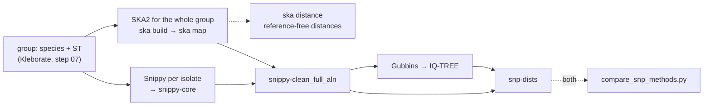

# Step by step: the pipeline's commands, one at a time

The Nextflow pipeline runs about 25 tools, in parallel, on every sample. That is efficient but hides what
happens. The scripts in this folder run **the same commands, with the same tools, versions and options**,
one step at a time in your terminal, so you can see each command, its inputs and its outputs before you
let Nextflow automate them.

Each script prints every command before running it (green lines starting with `$`). Read them; they are
the commands the pipeline's processes run. The results go into the same folder layout as the pipeline's
`--outdir` (`01_qc/`, `02_assembly/`, ...), so afterwards you can compare your results with the pipeline's.

## Before you start

**1. Get an interactive session on a compute node.** Do not run tools on the login node. On the course,
odd-numbered accounts (`user1`, `user3`, …) use `compute05` and even-numbered ones (`user2`, `user4`, …) use
`compute06`, with 1 CPU (`start_session` from the course's Day 1 setup picks the node for you):

```bash
interactive -w compute05 -c 1        # odd account numbers; even numbers: interactive -w compute06 -c 1
cd /path/to/neonatal-amr-nf          # the pipeline folder
module load singularity              # or apptainer; whatever `module avail` shows on your HPC
```

Step 02 (Kraken2) loads the whole database into memory: the course's Standard-8 database needs about 8 GB.

**2. Check the settings** at the top of `step_by_step/config.sh`. The defaults use the 5-sample test set
and the course's shared images, references and Kraken2 database:

| Setting | Default | What it is |
|---|---|---|
| `SAMPLESHEET` | `assets/samplesheet_test_5samples.csv` | Same format as the pipeline: reads (`fastq_1,fastq_2[,long_fastq]`) or assemblies (`fasta`) |
| `OUTDIR` | `/var/scratch/global/$USER/neonatal-amr/step_by_step` | Where your results go |
| `CONTAINERS` | `.../shared/containers` | The pipeline's Singularity images (read-only) |
| `REFERENCES` | `.../shared/references` | Reference genomes for the phylogeny (step 11) |
| `KRAKEN2_DB` | `$SHARED/databases/kraken2` | Kraken2 Standard-8 + Bracken database (step 02; course trainer guide, section 5) |
| `AMRFINDER_DB` | `$SHARED/databases/amrfinderplus/latest` if present | AMRFinderPlus database; empty = download it in step 08 (needs internet) |
| `MIN_GROUP` | 2 | Smallest species + ST group that gets a phylogeny |
| `PHYLO_METHOD` | `snippy` | How step 11 finds SNPs, as the pipeline's `--phylo_method`: `snippy`, `ska2` or `both` (to compare them) |
| `SKA_K` | 31 | SKA2 split k-mer length (step 11 with `ska2` or `both`) |
| `BAKTA_DB` | `$SHARED/databases/bakta/db-light` | Bakta light database (optional step 10b; course trainer guide, section 5) |
| `TOOL_MODE` | `singularity` | `singularity`: tools from the pipeline's images; `module`: tools on your `PATH` |
| `THREADS`, `MEM_GB` | your Slurm allocation (1 CPU in a course session) | CPUs and memory given to the tools |

You can also set any of these for a single run without editing the file:
`OUTDIR=$PWD/my_results bash step_by_step/01_fastp.sh`.

**3. Run step 00.** It lists your samples, checks that the input files exist, and prints every tool's
version (which also proves that each container works):

```bash
bash step_by_step/00_check_setup.sh
```

## The steps

Run them in order. Each per-sample step takes sample names as arguments:

```bash
bash step_by_step/01_fastp.sh                 # the first sample in the samplesheet
bash step_by_step/01_fastp.sh CHI11E BHB7VE   # these samples
bash step_by_step/01_fastp.sh all             # every sample
```

Start with one sample (`CHI11E`, the default, has both Illumina and ONT reads), look at the results, and
then run the remaining samples with `all`.

| Step | Script | Tools | Pipeline process(es) | Results in | Course day |
|---|---|---|---|---|---|
| 00 | `00_check_setup.sh` | all (versions) | | | 1 |
| 01 | `01_fastp.sh` | fastp 1.3.6 | `FASTP` | `01_qc/fastp/` | 1 |
| 02 | `02_kraken2_bracken.sh` | Kraken2 2.1.6, Bracken 3.1 | `KRAKEN2_KRAKEN2`, `BRACKEN_BRACKEN` | `01_qc/kraken2/`, `01_qc/bracken/` | 1 |
| 03 | `03_long_read_qc.sh` | Filtlong 0.2.1, NanoPlot 1.47.0 | `FILTLONG`, `NANOPLOT` | `01_qc/filtlong/`, `01_qc/nanoplot/` | 1 |
| 04 | `04_shovill.sh` | Shovill 1.1.0 (SPAdes) | `SHOVILL` | `02_assembly/shovill/` | 2 |
| 05 | `05_hybrid_assembly.sh` | Autocycler 0.6.2 (Flye 2.9.5, Raven 1.6.1), Medaka 2.2.2, Polypolish 0.6.0, Pypolca 0.4.0 | `AUTOCYCLER_ASSEMBLE`, `MEDAKA`, `POLYPOLISH_SHORTREAD`, `PYPOLCA_RUN` | `02_assembly/autocycler/`, `02_assembly/hybrid/` | 2 |
| 06 | `06_quast.sh` | QUAST 5.3.0 | `QUAST` | `02_assembly/quast/` | 2 |
| 07 | `07_typing.sh` | Kleborate 3.2.4 (with Kaptive); *E. coli*: ECTyper 1.0.0, EzClermont 1.0.0 | `KLEBORATE`, `KAPTIVE`, `ECTYPER`, `EZCLERMONT` | `03_typing/` | 3, 8 |
| 08 | `08_amrfinderplus.sh` | AMRFinderPlus 4.2.7 | `AMRFINDERPLUS_UPDATE`, `AMRFINDERPLUS_RUN` | `04_amr/amrfinderplus/` | 3-4 |
| 09 | `09_mobsuite.sh` | MOB-suite 3.1.9 | `MOBSUITE_RECON` | `05_plasmids/mobsuite/` | 4-5 |
| 10 | `10_prokka.sh` (optional) | Prokka 1.15.6 | `PROKKA` (`--run_prokka`) | `02_assembly/prokka/` | 5 |
| 10b | `10b_bakta.sh` (optional) | Bakta 1.12.0 | `BAKTA_BAKTA` (`--run_bakta`) | `02_assembly/bakta/` | 5 |
| 11 | `11_phylogeny.sh` | Snippy 4.6.0 and/or SKA2 0.5.1 (`PHYLO_METHOD`), Gubbins 3.3.5, IQ-TREE 3.1.3, snp-dists 0.8.2 | `SNIPPY_RUN`/`SNIPPY_CONTIGS`, `SNIPPY_CORE` and/or `SKA2`; `SNIPPY_CLEAN`, `GUBBINS`, `IQTREE`, `SNPDISTS` | `06_phylogeny/` | 6-7 |
| 12 | `12_multiqc.sh` | MultiQC 1.35 | `MULTIQC` | `multiqc/` | 8 |

Each script's header explains what the step does, which options it uses and why, what it writes, and what
to look at in the results. Read it before you run the step: `less step_by_step/04_shovill.sh`.

### What each step needs, and how long it takes (one isolate, 1 CPU)

Rough estimates for a course session with 1 CPU; with more CPUs most steps are faster.

| Step | Needs | Time |
|---|---|---|
| 01 fastp | reads | 2-5 min |
| 02 Kraken2/Bracken | step 01; ~8 GB RAM (Standard-8) | 5-15 min (plus loading the database) |
| 03 long-read QC | ONT reads (others are skipped) | 5-10 min |
| 04 Shovill | step 01 | 45-90 min |
| 05 hybrid assembly | steps 01 and 03; ONT reads | several hours (eight assemblies): use `run_all.sh` as a batch job, or the pre-computed assemblies |
| 06 QUAST | step 04 (and 05) | 1-2 min |
| 07 typing | an assembly | 5-10 min |
| 08 AMRFinderPlus | an assembly; the database | 2-5 min |
| 09 MOB-suite | an assembly | 5-10 min |
| 10 Prokka | an assembly | 15-30 min |
| 10b Bakta | an assembly; the Bakta database | 10-30 min |
| 11 phylogeny | step 07 for all samples; reads or assemblies | Snippy: 20-45 min per isolate; SKA2: a few minutes per isolate (one run per group); plus Gubbins and IQ-TREE. `both` takes the sum |
| 12 MultiQC | any QC results | < 1 min |

**Which assembly is used from step 06 on?** The same one as in the pipeline: the hybrid assembly (step 05)
if the sample has one, otherwise Shovill's contigs (step 04). With an assembly samplesheet, the `fasta`
from the samplesheet is used and steps 01-05 are not needed.

**Phylogeny groups (step 11).** As in the pipeline, isolates are grouped by the species and ST that
Kleborate reports (e.g. `Kpneumoniae_ST39`), and each group is mapped to the reference listed for its
species in `conf/phylo_references.csv`. So run step 07 on all samples first. A group needs at least
`MIN_GROUP` isolates. Gubbins and IQ-TREE need 4 sequences (the reference plus 3 isolates), so a group of
2 gets SNP distances only.

**Snippy, SKA2 or both (step 11).** `PHYLO_METHOD` works like the pipeline's `--phylo_method`:



- `snippy` (default): each isolate's reads (or contigs) are mapped to the group's reference, then
  `snippy-core` builds the alignment. Results in `06_phylogeny/<group>/`.
- `ska2`: SKA2 splits the reads (or contigs) of all the group's isolates into split k-mers at once, without
  mapping, and `ska map` lays them on the same reference, so Gubbins, IQ-TREE and snp-dists run as for
  Snippy. `ska distance` also gives SNP distances without any reference (`<group>.ska_distances.tsv`).
- `both`: Snippy's results in `06_phylogeny/<group>/`, SKA2's in `06_phylogeny/<group>_ska2/`, then
  `bin/compare_snp_methods.py` writes `06_phylogeny/snippy_vs_ska2_pairs.tsv` (every pair of isolates with
  both distances) and `snippy_vs_ska2_summary.tsv` (per group: how well they agree, and which pairs each
  method calls close, at 20 SNPs or fewer).

```bash
PHYLO_METHOD=both bash step_by_step/11_phylogeny.sh
column -t $OUTDIR/06_phylogeny/snippy_vs_ska2_summary.tsv
```

## Running every step at once

`run_all.sh` runs all the steps for all samples, one after another. This is what the pipeline automates:

```bash
mkdir -p logs
sbatch step_by_step/run_all.sh                       # as a Slurm job (8 CPUs, 32 GB, compute05)
SKIP="05 10 10b" bash step_by_step/run_all.sh        # in your session, without the hybrid assembly and annotation
PHYLO_METHOD=both sbatch step_by_step/run_all.sh     # step 11 with Snippy and SKA2, compared
```

Prokka (step 10) and Bakta (step 10b) are skipped by default, as in the pipeline. Add them with
`SKIP="" sbatch step_by_step/run_all.sh`, or only Bakta with `SKIP=10 sbatch step_by_step/run_all.sh`.

## Then run the pipeline and compare

```bash
sbatch submit_neonatal_amr.sbatch                    # the same 5 samples, with Nextflow
```

The pipeline writes to `/var/scratch/global/$USER/neonatal-amr/outdir_test`, with the same folder layout
as your step-by-step results. Compare them:

```bash
STEPS=/var/scratch/global/$USER/neonatal-amr/step_by_step
PIPE=/var/scratch/global/$USER/neonatal-amr/outdir_test
diff <(cut -f1-20 $STEPS/03_typing/kleborate/CHI11E.kleborate.txt) <(cut -f1-20 $PIPE/03_typing/kleborate/CHI11E.kleborate.txt)
diff $STEPS/04_amr/amrfinderplus/CHI11E.tsv $PIPE/04_amr/amrfinderplus/CHI11E.tsv
```

Identical inputs, tools and options give the same calls. Expect small differences in two places:
- **Assemblies.** SPAdes and Flye are not fully deterministic between runs, so contig numbers and lengths
  can differ slightly. Typing and AMR calls should not change.
- **The AMRFinderPlus database.** If the two runs downloaded the database on different dates, the results
  can differ. Use the same `AMRFINDER_DB` for both, e.g. the pipeline's
  `outdir_test/databases/amrfinderdb.tar.gz`.

Questions to discuss after both runs:
1. Your steps ran one after another; how does Nextflow run them? (Look at the pipeline's
   `pipeline_info/execution_timeline_*.html`.)
2. What happens if step 07 fails for one sample in your scripts, and in the pipeline? (Hint: `-resume`.)
3. Where does each pipeline process keep the exact command it ran? (Look for `.command.sh` in the pipeline's
   `work/` folder, and compare it with the green lines from these scripts.)

## Using installed tools (module load) instead of containers

With `TOOL_MODE=module`, the scripts run the tools from your `PATH`. Load modules with the same versions
first (the module names below are examples; use what `module avail` shows on your HPC):

```bash
module load fastp/1.3.6 kraken2/2.1.6 bracken/3.1 shovill/1.1.0 quast/5.3.0 \
            kleborate/3.2.4 amrfinderplus/4.2.7 mob_suite/3.1.9 snippy/4.6.0 \
            gubbins/3.3.5 iqtree/3.1.3 snp-dists/0.8.2 multiqc/1.35
TOOL_MODE=module bash step_by_step/00_check_setup.sh      # every tool must report a version
```

Hybrid assembly also needs filtlong, NanoPlot, autocycler (with flye and raven), medaka, polypolish (with
bwa) and pypolca. For *E. coli*, also load ectyper and ezclermont; for step 10, prokka; for step 10b,
bakta/1.12.0; for step 11 with `PHYLO_METHOD=ska2` or `both`, ska2/0.5.1 (its command is `ska`).

## How the scripts work

- `config.sh` holds the settings and a few helpers. Every step script loads it first.
- `run PROCESS command ...` prints the command and runs it inside the image of that pipeline process
  (`singularity exec <image> command ...`). It finds the image in the shared folder's `MANIFEST.tsv`.
  `run_sh` does the same for command lines with pipes, loops or redirections.
- To use another image for one process: `IMG_SHOVILL=/path/shovill.sif bash step_by_step/04_shovill.sh`.
- Each tool's working files stay in a `<sample>_work/` folder next to its results, so you can look at
  everything the tool wrote. The pipeline keeps these in its `work/` folder instead.

## Differences from the pipeline

The commands and options are the same. The way they are run differs:

- Steps run one after another, not in parallel, and there is no `-resume`. Running a step again redoes it.
  The exception is step 11, which keeps Snippy results that already exist.
- Nextflow chooses the CPUs, memory and node for each process (`conf/slurm.config`). Here every step uses
  your session's `THREADS` and `MEM_GB`.
- A few file-handling details differ, without changing results:
  - fastp reads the FASTQ files directly; the pipeline first links them under the sample name.
  - Medaka's output is not gzipped.
  - `snippy-core` reads the Snippy folders directly; the pipeline first copies the VCF and alignment files
    into a `samples/` folder.
  - SKA2 also leaves its split k-mer file (`<group>.skf`) and `ska map`'s own alignment in the group folder;
    the pipeline publishes only the full alignment, the distances and the input list.
  - Step 08 unpacks a `.tar.gz` database once into `OUTDIR/databases/`.

## Troubleshooting

| Message | What to do |
|---|---|
| `no image for process X in .../MANIFEST.tsv` | The trainer has not prepared that image (`bin/prepare_shared_containers.sh --check`), or use `IMG_X=/path/image.sif` |
| `singularity/apptainer not found` | `module load singularity` (or apptainer) |
| `... not found or empty: run step NN first` | Run the step it names for that sample first |
| `Kraken2 database not found` | Set `KRAKEN2_DB` to the database folder |
| Kraken2 is killed, or `std::bad_alloc` | Not enough memory: Standard-8 needs about 8 GB, so start the session with `--mem=16G` or more (the full Standard database needs about 100 GB) |
| A container cannot see your files | Add their top folder to `BINDS` in `config.sh` (e.g. `BINDS="/var/scratch,/export/data,$HOME,/data"`) |
| `PHYLO_METHOD must be snippy, ska2 or both` | Check the spelling: `PHYLO_METHOD=both bash step_by_step/11_phylogeny.sh` |
| `no image for process SKA2` | The shared images predate SKA2: the trainer re-runs `bin/prepare_shared_containers.sh` |
| `no Bakta database in ...` | Set `BAKTA_DB`, or skip step 10b (the trainer guide, section 5.1, shows the download) |
| `group ... has 1 isolate(s) (< MIN_GROUP=2); skipped` | Expected: a phylogeny needs at least two isolates of the same species and ST |
| AMRFinderPlus download fails | The compute node has no internet. Run step 08 once on the login node, or set `AMRFINDER_DB` |
